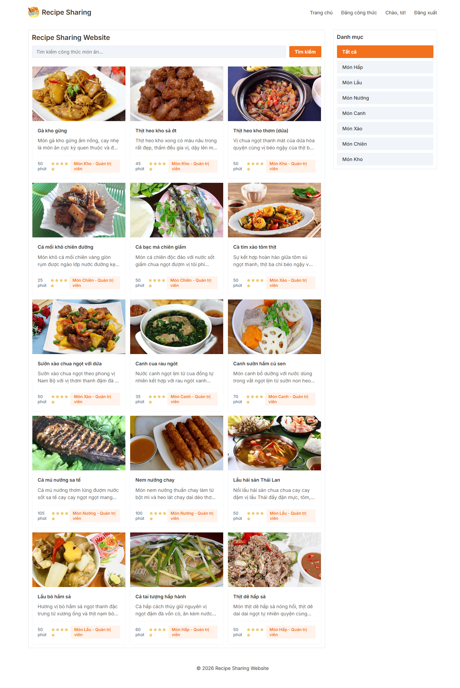
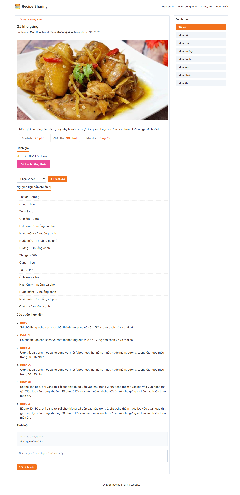
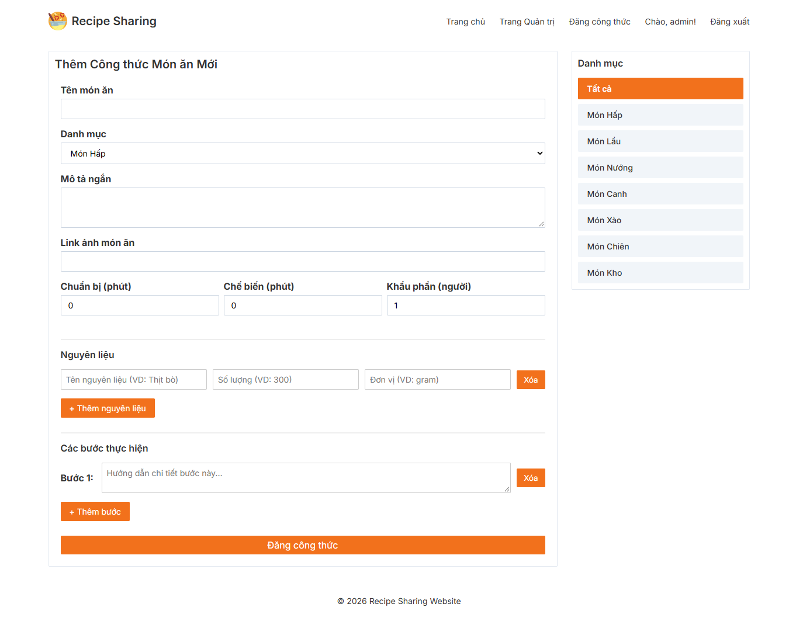
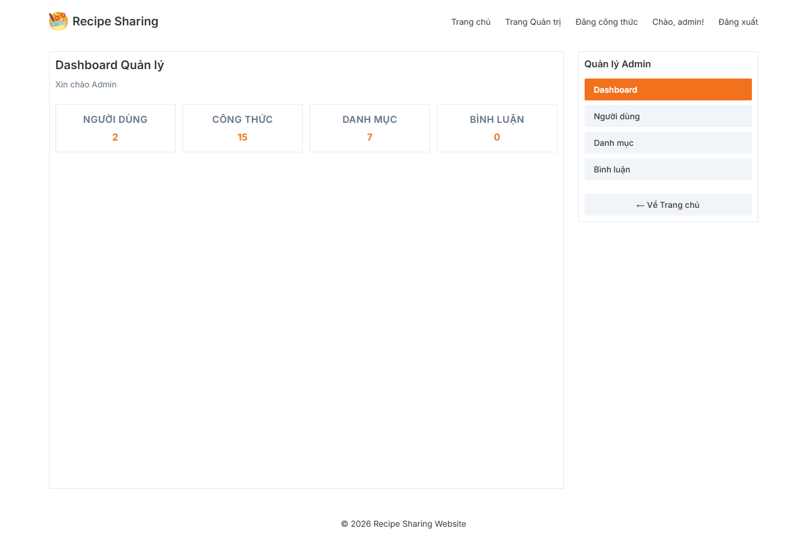
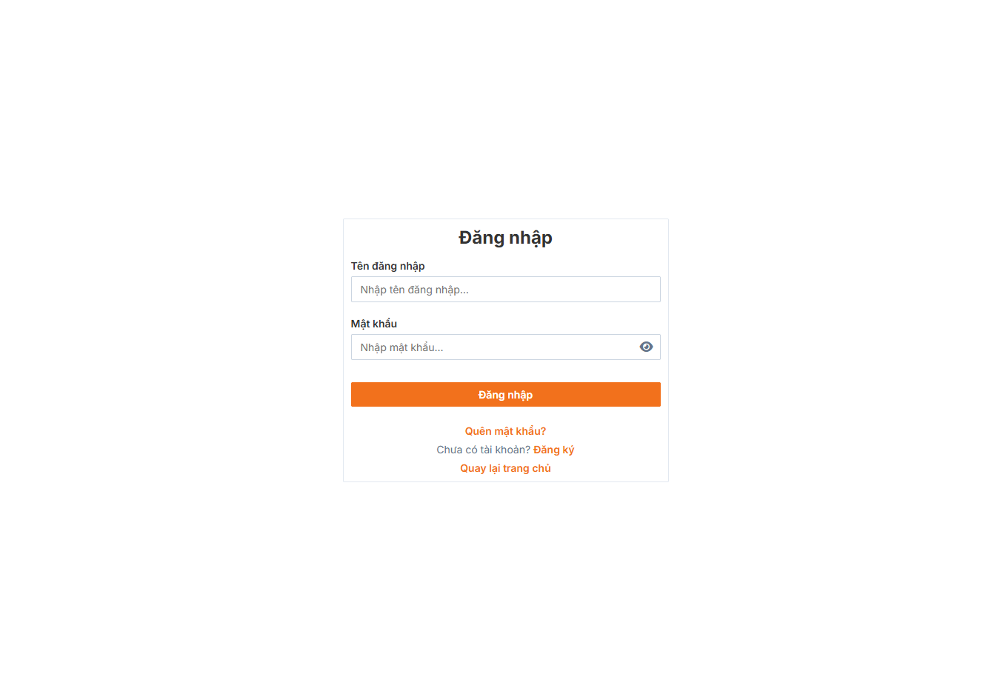
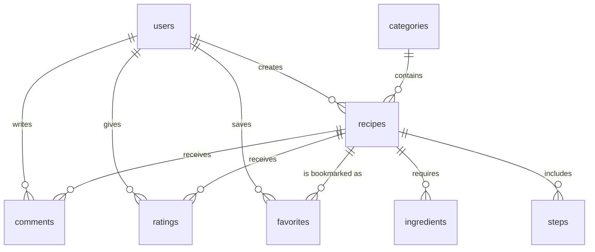

# Recipe Sharing Web

A web application for discovering, creating, and interacting with cooking recipes.

## Overview

Recipe Sharing Web is a platform where users can browse a catalog of recipes, register accounts, and publish their own cooking instructions. Users can interact with existing recipes by commenting, rating, and bookmarking their favorites. Administrators have access to a dashboard to monitor platform statistics and manage user accounts.

## Screenshots

<table align="center">
  <tr>
    <td align="center" width="50%">
      <strong>Home Page</strong><br>
      
    </td>
    <td align="center" width="50%">
      <strong>Recipe Detail Page</strong><br>
      
    </td>
  </tr>
  <tr>
    <td align="center" width="50%">
      <strong>Create Recipe Form</strong><br>
      
    </td>
    <td align="center" width="50%">
      <strong>Admin Dashboard</strong><br>
      
    </td>
  </tr>
  <tr>
    <td align="center" colspan="2">
      <strong>Login</strong><br>
      
    </td>
  </tr>
</table>

## Tech Stack

### Frontend

- React 19 + Vite (SPA in `frontend/`)
- React Router, Axios, react-hot-toast
- Cloudinary (direct browser uploads for recipe photos/videos)

### Backend

- Node.js
- Express.js

### Database

- MySQL
- Prisma ORM

### Authentication & Security

- bcrypt
- express-session
- express-mysql-session

### Other

- Nodemailer (OTP emails via Gmail)
- Google Gemini (`@google/genai`) – find a dish from a photo
- Hybrid recommender (popularity, TF-IDF content-based, item-based CF) in `services/recommender/`

## Architecture

The application uses a layered structure that partially implements the Service-Repository pattern, separating request handling, business logic (for authentication), and data access.

- Routes: Define application endpoints.
- Controllers: Handle HTTP requests and responses.
- Services: Implement business logic.
- Repositories: Handle database access.
- Frontend: React SPA (`frontend/`) calling the REST API under `/api`.

## Project Structure

```text
recipe-sharing-web/
├── config/            # Prisma client
├── controllers/       # HTTP handlers
├── data/vifoodrec/    # ViFoodRec dataset (import script input)
├── docs/              # Recommender algorithm notes & evaluation results
├── frontend/          # React + Vite SPA
├── middlewares/       # auth, session refresh, rate limiting
├── prisma/
│   └── schema.prisma
├── public/images/     # README screenshots
├── repositories/      # Data access (Prisma)
├── routes/
├── scripts/           # data import, simulation, evaluation, DB migrations
├── services/          # auth, Gemini, recommender
├── tests/             # node:test unit tests (npm test)
├── utils/             # mail, validation helpers
├── init_db.sql        # base tables + seed data
├── package.json
└── README.md
```

## Requirements

- Node.js
- npm
- MySQL

## Installation

### 1. Clone the repository

```bash
git clone https://github.com/td1205/recipe-sharing-web.git
cd recipe-sharing-web
```

### 2. Install dependencies

```bash
npm install
```

### 3. Configure environment variables

Copy `.env.example` to `.env` (backend) and `frontend/.env.example` to `frontend/.env` (Cloudinary), then fill in the values (see the Environment Variables section below).

### 4. Configure the database

Legacy local bootstrap below creates seed data and changes schema. Use it ONLY for a newly provisioned disposable database after explicit approval; never run it against an existing development/production database or as part of tests. For deployment use the reviewed schema/migration procedure, not this bootstrap:

```bash
mysql -u root -p < init_db.sql
npx prisma db push
npx prisma generate
```

Upgrading an existing database: run `npm run db:ratings-unique` once to remove duplicate ratings and add the `UNIQUE(user_id, recipe_id)` constraint on `ratings`.

### 5. Start the application

```bash
npm run dev
```

## Environment Variables

| Variable             | Description                                | Required |
| -------------------- | ------------------------------------------ | -------- |
| `DATABASE_URL`       | Prisma database connection string          | Yes      |
| `DB_HOST`            | MySQL database host                        | Yes      |
| `DB_PORT`            | MySQL database port                        | Yes      |
| `DB_USER`            | MySQL database user                        | Yes      |
| `DB_PASSWORD`        | MySQL database password                    | Yes      |
| `DB_NAME`            | MySQL database name                        | Yes      |
| `SESSION_SECRET`     | Secret string for securing sessions        | Yes      |
| `EMAIL_USER`         | Email address for sending OTPs             | Yes      |
| `EMAIL_APP_PASSWORD` | Application password for the email account | Yes      |
| `GEMINI_API_KEY`     | Google Gemini key for photo search ([get one](https://aistudio.google.com/apikey)) | For photo search |
| `GEMINI_MODELS`      | Optional comma-separated model list to try in order | No |
| `VITE_CLOUDINARY_CLOUD_NAME` (in `frontend/.env`) | Cloudinary cloud name | Yes |
| `VITE_CLOUDINARY_UPLOAD_PRESET` (in `frontend/.env`) | Unsigned upload preset | Yes |

## Database Setup

The application uses MySQL as the primary database. Prisma ORM is used for database access across the application, while direct MySQL configuration is used for session management (`express-mysql-session`). The schema includes the following entities:

- User
- Recipe
- Category
- Comment
- Rating
- Favorite
- Ingredient
- Step
- Session

### Entity-Relationship Diagram (ERD)



## Security

The application implements the following security measures:

- **Password Hashing:** Passwords are encrypted using bcrypt before being stored in the database.
- **Session Management:** Sessions are securely stored in the MySQL database using `express-mysql-session`, preventing in-memory leaks.
- **Role-based Access Control:** Middleware is used to restrict access to admin-only routes.
- **OTP Verification:** Password recovery requires a one-time password (OTP) delivered via email; it expires after 5 minutes, allows at most 5 wrong attempts and is single-use.
- **Rate Limiting:** Login (5 failed attempts / 15 min per account), OTP requests (3 / 10 min per email) and registration (10 / hour per IP) are throttled.
- **Input Validation:** Recipe create/update requests are validated server-side and return `400` with a Vietnamese message instead of a generic `500`.
- **XSS Protection:** Article HTML is sanitized before rendering.

## Running the Application

To start the application in development mode with auto-reloading:

```bash
npm run dev
```

The frontend runs at `http://localhost:5173` (Vite, proxying `/api` to the backend on port 3000).

Run the unit tests (no database needed):

```bash
npm test
```

## Usage

### User

1. Register an account and log in.
2. Browse recipes on the homepage.
3. Use the navigation bar to add a new recipe with ingredients and steps.
4. Open a recipe to comment, rate, or save it to your bookmarks.
5. View and manage your created or saved recipes.

### Admin

1. Log in with an administrator account.
2. Open the Admin Dashboard from the navigation menu.
3. View platform statistics.
4. Manage users and update roles.

## Testing

### Isolated MySQL integration (prepared, NOT VERIFIED)

`npm run test:database` skips by default without loading dotenv, Prisma, MySQL or the app. To opt in, an operator must first provision disposable **empty** databases with the approved current schema, including the session table. Provisioning/migrations are not part of the test command.

Set `RUN_DATABASE_TESTS=yes`, `TEST_DB_CONFIRMED=yes`, `TEST_DATABASE_URL` and `TEST_SESSION_DATABASE_URL` explicitly in the test process. Both URLs must use loopback MySQL and database names matching `recipe_test_*`; `recipe_db` and remote hosts are rejected. The harness verifies `SELECT DATABASE()`, empty users and empty sessions before creating fixtures. It tests HTTP login/logout/permissions, recipe CRUD, interactions, SQL listing, pantry recommendations, last-admin competition and injected recipe/tag rollback, then removes only its own fixture IDs. Email/AI/Cloudinary adapters are blocked. Do not opt in against a shared database; credentials need access only to the disposable test databases. This harness has not been run against MySQL in this work session.

### Production deployment and recovery (procedures, NOT VERIFIED)

Use a pinned release artifact and Node >=22.12. Run `npm ci`, `npm ci --prefix frontend`, `npm run test:safe`, `npm run lint --prefix frontend`, and `npm run build --prefix frontend` in the build environment. CI also executes the isolated loopback router and Gemini mock tests; no CI database mutation job is enabled.

Set `NODE_ENV=production`, a random `SESSION_SECRET` of at least 32 characters, a canonical HTTPS `APP_ORIGIN` without trailing slash, a MySQL `DATABASE_URL`, and the independent `DB_HOST/DB_PORT/DB_USER/DB_PASSWORD/DB_NAME` session-store configuration. Behind TLS termination, allow only the actual proxy IP/subnets in `TRUST_PROXY`. Verify HTTPS cookie Secure/HttpOnly/SameSite behavior and rejection of forged forwarded headers on staging. Persist `uploads/avatars` outside release replacement and protect backup access. Startup does not create session tables or run migrations.

`npm start` starts the release. `/healthz` is process liveness; `/readyz` probes both Prisma and the session table and returns 503 on timeout, failure or drain without revealing connection details. SIGTERM/SIGINT stop admission through readiness, drain HTTP, close idle connections, session pool and the shared Prisma client; a ten-second deadline terminates a stuck shutdown. Probe timeout does not cancel a driver query, so driver connection timeouts must also be bounded in deployment configuration.

Before any approved deployment, take a consistent backup using a restricted backup account (for example `mysqldump --login-path=recipe-backup --single-transaction --routines --triggers --result-file=backup.sql recipe_db`). Encrypt and restrict access to the dump: it can contain personal data, password hashes and sessions. Do not store it in Git. Record the release/schema versions and checksum outside public logs.

Rehearse restore only into a separately verified disposable `recipe_test_restore` database with a test-only login path. Inspect the dump for `USE`, `CREATE DATABASE`, qualified production names, and definers before import; never import a dump blindly through a production account. Verify table counts, constraints, session isolation and critical journeys after restore. No backup or restore command was executed here.

For rollback, redeploy the previous validated artifact only after checking schema compatibility. If a data/schema rollback is necessary, stop writes and follow a reviewed restore/migration plan with an approved backup; do not use code rollback as proof that data was restored. Migration history, clean-clone deployment, remote CI execution, live outage recovery, reverse-proxy TLS and restore rehearsal remain NOT VERIFIED until staging and permission are provided.

### Offline recommendation evaluation

`npm run recommend:evaluate:offline -- INPUT.json OUTPUT.json` reads only a local dataset and never connects to a database or external service. Output must not already exist. Input requires `kind` (`real` or `simulated`), a provenance `label`, `recipes` with unique IDs/title/ingredients/tags, and `interactions` with pseudonymous integer user IDs, recipe IDs and favorite/rating/comment/view types (ratings 1–5). Do not export names, emails, session IDs or credentials. A single file must represent one verified source kind; the operator must confirm provenance because the validator cannot establish it independently.

The report compares popularity, content, CF, hybrid and switching on the same seeded leave-one-out split, K=10 and production diversification; it records Precision@10, Recall@10, NDCG@10, seeds, settings and model/dataset hashes. Cold-start histories use the same protocol. Recall equals HitRate with one held-out positive. No eligible users produces an error rather than a misleading all-zero quality report. The local ViFoodRec archive supplies recipes only; no approved interaction dataset was found, so no relevance scores were generated in this work session. Fixture tests verify protocol mechanics only. Temporal evaluation and real-user A/B remain separate work requiring suitable data/permission.

Run `npm run test:safe` for the explicitly selected memory-only suite. Route sandbox: `node --test tests/rateLimitRoutes.test.js` uses ephemeral loopback HTTP and mocked controllers/session store, not the live server. Tests do not establish real database atomicity or E2E coverage.

Production: build with `npm run build --prefix frontend`, then `npm start` (Node >=22.12). Required configuration: DATABASE_URL, DB_HOST, DB_USER, DB_NAME, SESSION_SECRET; DB_PASSWORD/DB_PORT must point to the intended session store. Use an independent test database for BOTH Prisma and sessions. No migration or seed runs automatically at startup. `/healthz` reports process liveness only, not database readiness.

Set PORT as needed. Behind TLS termination, explicitly set TRUST_PROXY to trusted proxy IPs/subnets and APP_ORIGIN to the public origin; do not trust arbitrary forwarded headers. Existing sessions created before password fingerprinting require login again. All old logged-in sessions are rejected on their next API request after a password change. OTP/reset grants expire after five minutes and successful reset consumes the previous password version atomically.

Before release: verify schema parity and migrations on a permitted database copy, rehearse backup/restore and rollback, confirm session-store isolation/TLS/proxy, persistent uploads and environment secrets. These deployment checks have not been executed on the real database.

## Future Improvements

- Extend isolated database integration and browser E2E tests
- Implement image upload functionality
- Improve recipe search and filtering
- Enhance input validation and error handling

## License

This project is licensed under the ISC License.

## Author

### Original Version

[td1205](https://github.com/td1205) - Project Lead <br>
[TuanHara](https://github.com/TuanHara) <br>
[23010710-duy](https://github.com/23010710-duy) <br>

### Version 2 — Current Development

[td1205](https://github.com/td1205) - Project Lead <br>
[TuanHara](https://github.com/TuanHara) <br>
