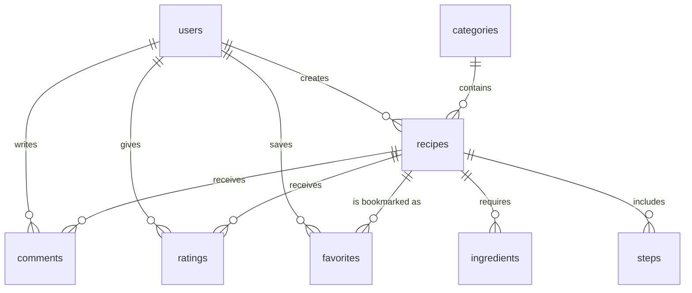

# Recipe Sharing Web

A web application for discovering, creating, and interacting with cooking recipes.

## Overview

Recipe Sharing Web is a platform where users can browse a catalog of recipes, register accounts, and publish their own cooking instructions. Users can interact with existing recipes by commenting, rating, and bookmarking their favorites. Administrators have access to a dashboard to monitor platform statistics and manage user accounts.

## Screenshots

<table align="center">
  <tr>
    <td align="center" width="50%">
      <strong>Home Page</strong><br>
      
    </td>
    <td align="center" width="50%">
      <strong>Recipe Detail Page</strong><br>
      
    </td>
  </tr>
  <tr>
    <td align="center" width="50%">
      <strong>Create Recipe Form</strong><br>
      
    </td>
    <td align="center" width="50%">
      <strong>Admin Dashboard</strong><br>
      
    </td>
  </tr>
  <tr>
    <td align="center" colspan="2">
      <strong>Login</strong><br>
      
    </td>
  </tr>
</table>

## Tech Stack

### Frontend

- React 19 + Vite (SPA in `frontend/`)
- React Router, Axios, react-hot-toast
- Cloudinary (direct browser uploads for recipe photos/videos)

### Backend

- Node.js
- Express.js

### Database

- MySQL
- Prisma ORM

### Authentication & Security

- bcrypt
- express-session
- express-mysql-session

### Other

- Nodemailer (OTP emails via Gmail)
- Google Gemini (`@google/genai`) – find a dish from a photo
- Hybrid recommender (popularity, TF-IDF content-based, item-based CF) in `services/recommender/`

## Architecture

The application uses a layered structure that partially implements the Service-Repository pattern, separating request handling, business logic (for authentication), and data access.

- Routes: Define application endpoints.
- Controllers: Handle HTTP requests and responses.
- Services: Implement business logic.
- Repositories: Handle database access.
- Frontend: React SPA (`frontend/`) calling the REST API under `/api`.

## Project Structure

```text
recipe-sharing-web/
├── config/            # Prisma client
├── controllers/       # HTTP handlers
├── data/vifoodrec/    # ViFoodRec dataset (import script input)
├── docs/              # Recommender algorithm notes & evaluation results
├── frontend/          # React + Vite SPA
├── middlewares/       # auth, session refresh, rate limiting
├── prisma/
│   └── schema.prisma
├── public/images/     # README screenshots
├── repositories/      # Data access (Prisma)
├── routes/
├── scripts/           # data import, simulation, evaluation, DB migrations
├── services/          # auth, Gemini, recommender
├── tests/             # node:test unit tests (npm test)
├── utils/             # mail, validation helpers
├── init_db.sql        # base tables + seed data
├── package.json
└── README.md
```

## Requirements

- Node.js
- npm
- MySQL

## Installation

### 1. Clone the repository

```bash
git clone https://github.com/td1205/recipe-sharing-web.git
cd recipe-sharing-web
```

### 2. Install dependencies

```bash
npm install
```

### 3. Configure environment variables

Copy `.env.example` to `.env` (backend) and `frontend/.env.example` to `frontend/.env` (Cloudinary), then fill in the values (see the Environment Variables section below).

### 4. Configure the database

Ensure your MySQL server is running and matches the credentials in your `.env` file. Create the base tables and seed data, then sync the remaining columns/tables from the Prisma schema and generate the client:

```bash
mysql -u root -p < init_db.sql
npx prisma db push
npx prisma generate
```

Upgrading an existing database: run `npm run db:ratings-unique` once to remove duplicate ratings and add the `UNIQUE(user_id, recipe_id)` constraint on `ratings`.

### 5. Start the application

```bash
npm run dev
```

## Environment Variables

| Variable             | Description                                | Required |
| -------------------- | ------------------------------------------ | -------- |
| `DATABASE_URL`       | Prisma database connection string          | Yes      |
| `DB_HOST`            | MySQL database host                        | Yes      |
| `DB_PORT`            | MySQL database port                        | Yes      |
| `DB_USER`            | MySQL database user                        | Yes      |
| `DB_PASSWORD`        | MySQL database password                    | Yes      |
| `DB_NAME`            | MySQL database name                        | Yes      |
| `SESSION_SECRET`     | Secret string for securing sessions        | Yes      |
| `EMAIL_USER`         | Email address for sending OTPs             | Yes      |
| `EMAIL_APP_PASSWORD` | Application password for the email account | Yes      |
| `GEMINI_API_KEY`     | Google Gemini key for photo search ([get one](https://aistudio.google.com/apikey)) | For photo search |
| `GEMINI_MODELS`      | Optional comma-separated model list to try in order | No |
| `VITE_CLOUDINARY_CLOUD_NAME` (in `frontend/.env`) | Cloudinary cloud name | Yes |
| `VITE_CLOUDINARY_UPLOAD_PRESET` (in `frontend/.env`) | Unsigned upload preset | Yes |

## Database Setup

The application uses MySQL as the primary database. Prisma ORM is used for database access across the application, while direct MySQL configuration is used for session management (`express-mysql-session`). The schema includes the following entities:

- User
- Recipe
- Category
- Comment
- Rating
- Favorite
- Ingredient
- Step
- Session

### Entity-Relationship Diagram (ERD)



## Security

The application implements the following security measures:

- **Password Hashing:** Passwords are encrypted using bcrypt before being stored in the database.
- **Session Management:** Sessions are securely stored in the MySQL database using `express-mysql-session`, preventing in-memory leaks.
- **Role-based Access Control:** Middleware is used to restrict access to admin-only routes.
- **OTP Verification:** Password recovery requires a one-time password (OTP) delivered via email; it expires after 5 minutes, allows at most 5 wrong attempts and is single-use.
- **Rate Limiting:** Login (5 failed attempts / 15 min per account), OTP requests (3 / 10 min per email) and registration (10 / hour per IP) are throttled.
- **Input Validation:** Recipe create/update requests are validated server-side and return `400` with a Vietnamese message instead of a generic `500`.
- **XSS Protection:** Article HTML is sanitized before rendering.

## Running the Application

To start the application in development mode with auto-reloading:

```bash
npm run dev
```

The frontend runs at `http://localhost:5173` (Vite, proxying `/api` to the backend on port 3000).

Run the unit tests (no database needed):

```bash
npm test
```

## Usage

### User

1. Register an account and log in.
2. Browse recipes on the homepage.
3. Use the navigation bar to add a new recipe with ingredients and steps.
4. Open a recipe to comment, rate, or save it to your bookmarks.
5. View and manage your created or saved recipes.

### Admin

1. Log in with an administrator account.
2. Open the Admin Dashboard from the navigation menu.
3. View platform statistics.
4. Manage users and update roles.

## Testing

Automated tests are not currently configured.

## Future Improvements

- Add automated tests
- Implement image upload functionality
- Improve recipe search and filtering
- Enhance input validation and error handling

## License

This project is licensed under the ISC License.

## Author

### Original Version

[td1205](https://github.com/td1205) - Project Lead <br>
[TuanHara](https://github.com/TuanHara) <br>
[23010710-duy](https://github.com/23010710-duy) <br>

### Version 2 — Current Development

[td1205](https://github.com/td1205) - Project Lead <br>
[TuanHara](https://github.com/TuanHara) <br>
